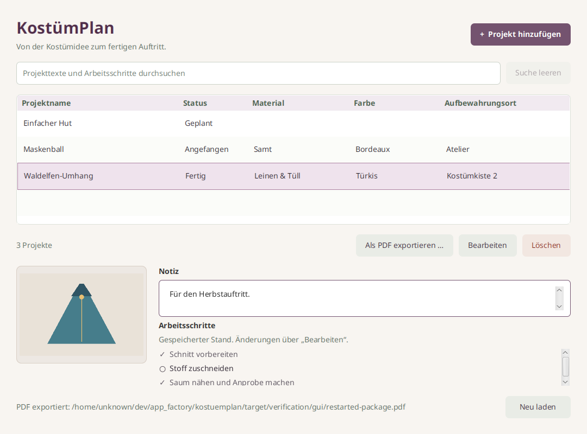

# KostümPlan

Von der Kostümidee zum fertigen Auftritt. Verwalte kleine Kostümprojekte mit Projektname,
Stoff oder Material, Farbe, Aufbewahrungsort, mehrzeiliger Notiz, einem
optionalen Foto und dem Status **Geplant**, **Angefangen** oder **Fertig**.
Die Checkliste hält deine Arbeitsschritte fest. Ein gespeichertes Projekt lässt
sich mit allen Inhalten als PDF exportieren. Alles bleibt lokal.



Stufe 5 der Java-Reihe BücherRegal → GarnBox → StrickProjekt → NähPlan → KostümPlan.
Die bisherige Reserve wurde am 26. Oktober 2026 ausdrücklich beauftragt.
Gegenüber NähPlan kommt genau eine Hauptfunktion hinzu: der PDF-Export eines Projekts.
Material ist Freitext ohne Verbindung zu anderen Apps.

## Starten

Ein vollständiges JDK 21 in `JAVA_HOME` und dessen `bin` im `PATH` verwenden.
Der Maven Wrapper lädt Maven und Abhängigkeiten beim ersten Start.
Die fertige App benötigt weder Konto noch Netzwerkzugriff.

Linux und macOS, aus diesem Verzeichnis:

```bash
./mvnw javafx:run
```

Windows PowerShell:

```powershell
.\mvnw.cmd javafx:run
```

Im vorhandenen Linux-Workspace findet `./scripts/run.sh` auch das JDK unter
`$HOME/.local/jdk-21`. Das lokale Paket mit eingebetteter Laufzeit startet so:

```bash
./target/app-image/KostuemPlan/bin/KostuemPlan
```

Der sichtbare Produktname lautet KostümPlan. Paketdateien, Launcher und
Datenverzeichnisse verwenden die ASCII-Schreibweise `KostuemPlan` beziehungsweise
`kostuemplan`. Die App-Kennung ist `de.appfabrik.kostuemplan`.

## Bedienung

„Projekt hinzufügen“ und „Bearbeiten“ öffnen denselben Dialog. Nur der
Projektname ist erforderlich. Gleichnamige Projekte sind unabhängig.
Neue Projekte beginnen mit „Geplant“ und einer leeren Checkliste.
Alle drei Statuswerte lassen sich jederzeit ineinander ändern.
Löschen verlangt eine Bestätigung und entfernt nur das ausgewählte Projekt
einschließlich seines Fotos und seiner Schritte.

„Arbeitsschritt hinzufügen“ ergänzt eine neue, noch offene Zeile am Ende.
Den Text direkt in der Zeile bearbeiten, das Kästchen abhaken oder wieder
öffnen und einzelne Zeilen mit „Entfernen“ entfernen. Gleichlautende Schritte
bleiben unabhängig. Leere Schritttexte werden mit einem verständlichen Hinweis
abgelehnt. Eingaben bleiben dabei erhalten. Eine vollständig leere Checkliste
ist gültig. Die Reihenfolge bleibt nach Speichern und Neustart erhalten.

**Erst „Speichern“ übernimmt Texte, Foto, Status und Checkliste gemeinsam.**
Abbrechen, Escape und Fensterschließen schützen auch ausschließliches Abhaken,
Wiederöffnen, Umbenennen, Hinzufügen oder Entfernen eines Schritts.
„Weiterbearbeiten“ ist die sichere Vorauswahl. „Verwerfen“ erhält den gespeicherten
Stand. Ein Speicherfehler lässt den Dialog mit dem gesamten Entwurf offen.
Die Checkliste im Hauptfenster zeigt ausschließlich den gespeicherten Stand.

Status und Checkliste bleiben unabhängig. Eine vollständig abgehakte Liste
setzt den Status nicht auf Fertig. Ein fertiges Projekt darf offene Schritte
haben. Statusänderungen beeinflussen keine Häkchen.

Die Suche durchsucht Projektname, Material, Farbe, Aufbewahrungsort, Notiz und
alle Schritttexte. Sie ignoriert Groß- und Kleinschreibung einschließlich Umlauten
und Unicode-Schreibvarianten. Mehrere passende Schritte erzeugen keine doppelten
Projekttreffer. Eine leere Suche zeigt alle Projekte.

## Foto

Genau ein JPEG oder PNG auswählen, ansehen, ersetzen oder entfernen.
KostümPlan prüft den tatsächlichen Bildinhalt und speichert eine eigene Kopie
in SQLite. Die Quelldatei wird niemals verändert oder gelöscht. Das Foto bleibt
nach Verschieben oder Löschen der Quelle erhalten.

Grenzen: 10 MiB (10.485.760 Bytes), 6000 Pixel je Seite und 16 Millionen Pixel
insgesamt. Abgebrochene Dateiauswahl oder fehlgeschlagener Import erhalten das
bisherige Entwurfsfoto. Verspätete Vorschauen werden nach Auswahlwechseln
verworfen. Während Import und Speichern wartet der Dialog auf den Abschluss.

## Ein Projekt als PDF mitnehmen

Im Hauptfenster ein Projekt auswählen und „Als PDF exportieren …“ anklicken.
Im nativen Speicherdialog den Zielordner wählen. KostümPlan schlägt einen
bereinigten Projektnamen mit `.pdf` vor. Ohne Auswahl bleibt die Aktion deaktiviert.
Eine vorhandene Datei wird nur nach ausdrücklicher Bestätigung ersetzt.
„Abbrechen“ ist bei der app-eigenen Rückfrage die sichere Vorauswahl.

Exportiert wird ausschließlich der gespeicherte Stand dieses einen Projekts:
Name, vorhandene Material-, Farb- und Ortsangaben, vollständige mehrzeilige Notiz,
deutscher Status, Foto und alle Schritte in ihrer Reihenfolge. „☑ Erledigt“ und
„☐ Offen“ kennzeichnen die Schritte. Interne IDs und Dateipfade erscheinen nicht.
Der Bearbeitungsdialog hat keine Exportaktion. Exportieren speichert keinen Entwurf.

Das feste A4-Hochformat verteilt lange Texte und Checklisten auf mehrere Seiten.
Auch lange Wörter werden umgebrochen. Das Foto bleibt proportional. Die Schrift
DejaVu Sans ist eingebettet, auch bei vollständig offline genutzten Paketen.
Umlaute, ß, Eurozeichen und übliche Satzzeichen werden dargestellt. Falls ein
Zeichen nicht unterstützt wird, bricht der Export mit seinem Unicode-Code ab,
etwa `U+1F9F5`. Bitte dieses Zeichen im Projekt ersetzen und speichern.
Es gibt keinen stillen Ersatz durch Leerzeichen. Details zu Unicode und Layout
stehen in [Architektur](docs/architecture.md).

Während der Erzeugung bleibt die Oberfläche ansprechbar. Ein zweiter Export
ist gesperrt. Die Erfolgsmeldung erscheint erst nach Abschluss. Eine temporäre
Datei im Zielordner schützt vorhandene PDFs bei Fehlern. Falls der Ordner die
benötigten sicheren Dateioperationen nicht unterstützt, einen anderen lokalen
Ordner wählen. Exporte auf FAT/exFAT oder spezielle Netzlaufwerke sind nicht
zugesichert. Das Projekt und Originalfotos bleiben unverändert.

## Tastatur

| Taste | Aktion |
| --- | --- |
| Strg+N / Cmd+N | Projekt hinzufügen |
| Strg+F / Cmd+F | Suche auswählen |
| Enter oder Doppelklick in der Projektliste | Projekt bearbeiten |
| Entf in der Projektliste | Nach Bestätigung löschen |
| Strg+S / Cmd+S | Gesamten Dialog speichern |
| Escape | Abbrechen mit Verwerfschutz |
| Leertaste auf einem Kästchen | Schritt abhaken oder wieder öffnen |
| Enter im Notizfeld | Neue Zeile |
| Tab / Umschalt+Tab | Steuerelement wechseln |

## Lokale Daten

`kostuemplan.db` enthält Projekte, Fotobytes und Arbeitsschritte.
Die Standardpfade liegen außerhalb von Programm und Quellcode.

| System | Datenverzeichnis |
| --- | --- |
| Windows | `%LOCALAPPDATA%\KostuemPlan`, sonst `~/AppData/Local/KostuemPlan` |
| macOS | `~/Library/Application Support/KostuemPlan` |
| Linux | `$XDG_DATA_HOME/kostuemplan`, sonst `~/.local/share/kostuemplan` |

Zum Sichern die App schließen und `kostuemplan.db` kopieren. SQLite kann nach dem
Entfernen von Fotos freien Platz intern behalten. Mehrere gleichzeitig
bearbeitende Instanzen werden nicht unterstützt.

Isolierter Teststart mit einem eigenen absoluten Pfad:

```bash
./scripts/run.sh '-Djavafx.args=--data-dir=/tmp/kostuemplan-test'
./target/app-image/KostuemPlan/bin/KostuemPlan --data-dir=/tmp/kostuemplan-test
```

## Prüfen und verstehen

```bash
./mvnw spotless:apply
./mvnw verify
```

`verify` umfasst JUnit, Compiler-Lint mit Warnungen als Fehlern, Enforcer,
Spotless und SpotBugs. Die zusätzlichen echten JavaFX-Dialogtests benötigen
einen grafischen Bildschirm und werden ausdrücklich aktiviert:

```bash
./mvnw verify -Dkostuemplan.uiTests=true
```

Tests verwenden temporäre SQLite-Dateien und synthetische Bilder.
[Prüfbericht und manuelle Abnahme](docs/verification.md) dokumentieren Ergebnisse
und Grenzen. [Architektur und Bewerbungsgespräch](docs/architecture.md) erklären
insbesondere den konsistenten Exportstand, getrennte PDF-Erzeugung,
Seitenumbrüche und sichere Dateioperationen.

Java 21, JavaFX 21.0.11, SQLite JDBC 3.53.4.0, PDFBox 3.0.8,
DejaVu Sans 2.37 und Maven 3.9.16 über Wrapper.
Ein Maven-Modul und ein eigenes Git-Repository. Keine gemeinsame Runtime mit
anderen Apps. [Paketierung](docs/packaging.md) bereitet Windows und macOS vor.
Native Zielplattformtests, Signierung und Store-Einreichungen stehen noch aus.
[Hinweise zu Fremdkomponenten](THIRD_PARTY_NOTICES.md).

Keine Unteraufgaben, Vorlagen, Abhängigkeiten, Termine, Verantwortlichen,
manuelle Umsortierung, automatischen Übergänge, Sammel-PDFs, PDF-Import,
PDF-Bearbeitung, Druckverwaltung, Cloud oder weitere
Hauptfunktionen. Es wurde nichts gepusht oder veröffentlicht.
