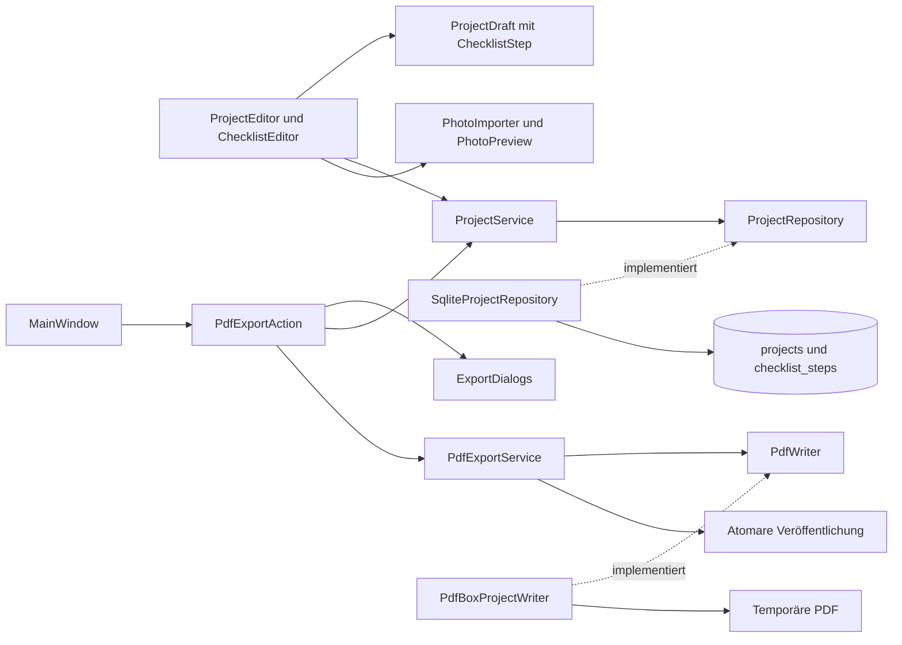

# Architektur und Bewerbungsgespräch

KostümPlan besteht aus einem Maven-Modul. CRUD, Suche, Fotoimport, Status,
Checklisten, Entwürfe und Paketierung wurden aus NähPlan gezielt angepasst.
Eigene Quellen, App-Kennung, Datenpfade und Git-Historie halten die App unabhängig.
Die neue Hauptfunktion der fünften Stufe ist der PDF-Export. Der Folgeauftrag
vom 1. November 2026 ergänzt einen farbigen Bericht und die gesamte Sammlung.

| Bereich | Aufgabe |
| --- | --- |
| `domain` | Unveränderliche Records für Projekte, Entwürfe und Schritte, Foto und Status-Enum |
| `application` | CRUD, Suche, Fotoimport, Speichervertrag ohne JavaFX oder JDBC |
| `persistence` | Datenpfad, Schema, JDBC und Transaktionen |
| `pdf` | A4-Layout, Schrift, Zeilen- und Seitenumbrüche ohne JavaFX oder Datenbank |
| `ui` | JavaFX-Fenster, gemeinsamer Entwurf, Checklistenfelder und Hintergrundarbeit |

Die Komponenten werden durch Konstruktoren verbunden. `ProjectsApplication`
ist der Einstieg für die Zusammensetzung. Ein Serial-Executor führt SQLite-
und Bildaufgaben aus. JavaFX-Task-Callbacks aktualisieren die Oberfläche auf
dem UI-Thread. Ressourcen werden mit `try-with-resources` geschlossen.

## Identität, Werte und Reihenfolge

`Project` trägt eine eigene SQLite-ID. Gleiche Namen sind erlaubt.
`ChecklistStep` ist ein Record mit `UUID id`, `String text`, `boolean completed`
und `int position`. Die UUID entsteht bereits beim Hinzufügen im Entwurf.
Umbenennen, Häkchen und Speichern ändern sie nicht. Text und Listenindex sind
keine Identität. Gleiche Schritttexte sind erlaubt.

Neue Schritte werden offen hinten angefügt. Positionen sind nicht negativ,
pro Projekt eindeutig und in aufsteigender Reihenfolge gespeichert. Beim
Entfernen dürfen Lücken bleiben. Die nächste Position liegt hinter der letzten
verbliebenen Zeile. Nach dem Öffnen wird ausdrücklich nach Position sortiert.
Es gibt keine Funktion zur manuellen Umsortierung.

`ChecklistStep` lehnt fehlenden Text und reinen Unicode-Leerraum ab.
`ProjectDraft` prüft den Namen sowie eindeutige Schritt-IDs und aufsteigende
Positionen. Defensive Listenkopien verhindern nachträgliche Veränderungen
an einem gespeicherten Stand. Notizformatierung bleibt erhalten.

| Status-Enum | Stabiler Speicherschlüssel | Anzeige |
| --- | --- | --- |
| `PLANNED` | `planned` | Geplant |
| `STARTED` | `started` | Angefangen |
| `FINISHED` | `finished` | Fertig |

Weder Ordinalzahlen noch übersetzte Anzeigen werden gespeichert. Neue Projekte
sind Geplant. Alle Wechsel sind erlaubt. Es gibt keine Abhängigkeit zwischen
Status und Häkchen. Auch Fertig mit offenen Schritten ist ein gültiger Zustand.

## Ein gemeinsamer Entwurf

`ProjectEditor.Input` hält die rohen Textwerte, das Foto, den Status und eine
unveränderliche Liste von `ChecklistEditor.StepInput`. Rohe Schritttexte dürfen
während der Eingabe leer sein. Erst Speichern erzeugt validierte Domain-Records.
Dadurch bleibt ein ungültiger Text im Dialog stehen und kann korrigiert werden.

Der ursprüngliche Input wird mit dem aktuellen Input verglichen. Record-
Gleichheit erfasst auch reine Häkchenänderungen, neue UUIDs, entfernte Zeilen
und umbenannte Texte. Abbrechen, Escape und Fensterschließen verwenden denselben
Verwerfschutz. „Weiterbearbeiten“ ist Standard, „Verwerfen“ schreibt nichts.

Die Hauptansicht verwendet für gespeicherte Schritte nur lesbare Labels.
Es gibt dort keine zweite Bearbeitungs- oder sofort speichernde Variante.
Während Import und Speichern sind konkurrierende Dialogaktionen gesperrt.
Bei Fehlern bleibt der gesamte Entwurf erhalten. Nur ein erfolgreicher
Speicher-Callback aktualisiert die Sammlung und schließt den Dialog.

## Gemeinsame SQLite-Transaktion

`projects` enthält Texte, Foto-BLOB und Status. `checklist_steps` enthält die
UUID, `project_id`, Text, Boolean als 0/1 und Position. Der Fremdschlüssel
verwendet `ON DELETE CASCADE`, jede Repository-Verbindung aktiviert ihn.
`UNIQUE(project_id, position)` verhindert doppelte Positionen. CHECK-Regeln
begrenzen Status, Schritttext, Boolean, Position und Fotogröße zusätzlich.

Ein vollständiges Speichern führt diese Schritte auf derselben Verbindung aus:

1. Auto-Commit deaktivieren und Projektzeile einfügen oder aktualisieren.
2. Bisherige Schritte dieses Projekts entfernen.
3. Den vollständigen Entwurfsstand mit denselben stabilen UUIDs einfügen.
4. Transaktion mit `commit()` abschließen und erst danach Erfolg zurückgeben.

Bei einem Fehler wird die gesamte Transaktion zurückgerollt. Ein erfolgreiches
Projekt-UPDATE genügt nicht, wenn später ein Schritt-INSERT scheitert. Tests
lösen genau diesen späten Fehler per SQLite-Trigger aus. Sie prüfen Texte,
Foto, Status, alte Schritte, neue Teilzeilen und erfolgreiches Wiederholen.
Auch ein fehlgeschlagenes Anlegen hinterlässt kein Teilprojekt.

Die vollständige Ersetzung der kleinen Liste hält den Code nachvollziehbar.
Die IDs bleiben dabei erhalten. Es gibt keine einzeln persistierenden
Schrittaktionen. Ein Löschvorgang entfernt die Projektzeile samt Foto und
zugehörigen Schritten. Andere gleichnamige Projekte bleiben erhalten.

Beim Laden werden beide Tabellen in einer Lesetransaktion gelesen. So gehören
Projekttexte und Schritte zum selben Datenbankstand. Fotos werden erst für das
ausgewählte Projekt geladen. Unbekannte neuere Schema-Versionen und ungültige
gespeicherte Werte führen zu einer Meldung statt stiller Reparatur.

## Suche und Fotos

Die Suche filtert die Projektliste einmal. Projekttexte oder mindestens ein
passender Schritt reichen als Treffer. `anyMatch` erzeugt auch bei mehreren
passenden Schritten nur einen Projekttreffer. NFC-Normalisierung und
`Locale.ROOT` behandeln Großschreibung und Umlaute. Ein deutscher `Collator`
sortiert nach Namen und danach nach Projekt-ID.

`PhotoImporter` prüft JPEG/PNG nach Inhalt, begrenzt Dateizugriff auf 10 MiB
plus ein Prüfbyte und prüft Dimensionen vor dem vollständigen Decodieren.
Maximal 6000 Pixel je Seite und 16 Millionen Pixel insgesamt. Decoderwarnungen
und Fehler werden abgelehnt. `Photo` kopiert Bytearrays defensiv und vergleicht
Inhalte. Originaldateien bleiben unverändert.

Erst erfolgreicher Import und erfolgreiche JavaFX-Decodierung ersetzen das
Entwurfsfoto. `PhotoPreview` verwirft verspätete Ergebnisse per Generationszähler.
Eine neue Auswahl kann dadurch kein Foto eines vorher ausgewählten Projekts
erhalten. Neue Fotoauswahlen berücksichtigen die EXIF-Ausrichtung und werden als
optimierte sRGB-Kopie gespeichert. Bestehende Bildbytes bleiben unverändert.

## Konsistenter gespeicherter Exportstand

`MainWindow` bietet im PDF-Menü Einzelprojekt und gesamte Sammlung an.
`PdfExportAction` hält die Projekt-ID einmal fest. Nach der Dateiauswahl und
gegebenenfalls der Überschreibbestätigung lädt `ProjectService.saved(id)`
den vollständigen Stand. `SqliteProjectRepository.findSaved` liest Projektzeile
mit Foto-BLOB und die nach Position sortierten Schritte auf derselben Verbindung
mit deaktiviertem Auto-Commit. Der erste SELECT legt den SQLite-Snapshot fest.

Der unveränderliche `ProjectDraft` dient auch hier als validierter vollständiger
Wert. Er löst keinen Speichervorgang aus. Die PDF erhält weder ein JavaFX-Control
noch ein veränderliches Tabellenobjekt. Die Lesetransaktion endet vor der
PDF-Erzeugung. Eine spätere Projektänderung kann den bereits geladenen Wert
nicht verändern. Tests wechseln parallel komplette Datenbankstände und prüfen,
dass Text, Foto, Status und Schritte stets zum selben Stand gehören.

`ProjectPdfSource` ergänzt einen Callback-Vertrag für mehrere vollständige
Projektstände. `ProjectService.allSaved()` bindet ihn an `ProjectRepository.readSaved`.
Die SQLite-Implementierung hält dieselbe Lesetransaktion während der gesamten
Sammlung offen. Eine nach App-Sprache sortierte Metadatenliste bestimmt die
Reihenfolge, danach wird je ein Foto mit seinen Projektdaten gelesen und sofort
an den Renderer übergeben. Parallele Änderungen können den Snapshot nicht mischen.
Die sichere Veröffentlichung folgt erst nach dem Ende der Lesetransaktion und
der vollständigen PDF-Erzeugung. Eine leere Quelle wird ausdrücklich abgelehnt.

Der bestehende Listenpfad lädt Fotos weiterhin erst bei Bedarf. Für den Export
werden dessen getrennte Listen- und Fotoladevorgänge ausdrücklich nicht kombiniert.
Ein Auswahlwechsel betrifft nur die Anzeige. Er ändert keine Export-ID.
Während eines Exports sind weitere Exporte sowie Änderungen und Neuladen gesperrt.
Suchen, Lesen und die Oberfläche bleiben ansprechbar. Das Hauptfenster lässt sich
während des Schreibens nicht schließen. Es wartet auf Erfolg oder Fehlermeldung.

## PDF-Erzeugung, Umbrüche und Schrift

`PdfWriter` ist ein kleiner Port. `PdfBoxProjectWriter` setzt ihn mit PDFBox 3.0.8
um. `ProjectPdfLayout` kapselt Zeichnen und Seitenfluss. Der Renderer erhält
eine Datenquelle über `ProjectPdfSource` und einen temporären Pfad. Der bisherige
Einzelprojekt-Aufruf bleibt als Default-Methode am Port verfügbar.
Er kennt keine Dateiauswahl, JavaFX-Steuerelemente oder SQLite-Verbindungen.
Alle Zustände einschließlich PDF-Dokument, Schriften, Breiten-Cache und aktueller
Seite gehören genau einem Aufruf. Ressourcen werden zuverlässig geschlossen.
PDFBox lagert Streams in temporäre Dateien aus, damit Bilder großer Sammlungen
nicht vollständig im Heap liegen. Jedes neue Projekt beginnt auf einer neuen Seite.
Die globale Seitennummer und Gesamtseitenzahl werden nach dem Rendern ergänzt.

A4-Hochformat, 48 Punkt Rand, 11 Punkt Text und 17 Punkt Zeilenabstand bilden
das feste Layout. Überschriften sind größer. Vor jeder Zeile wird der verbleibende
Platz geprüft. Abschnittsüberschriften reservieren Platz für eine erste Zeile.
Kopf- und Fußbereich sind vom Inhaltsbereich getrennt. Zeilen werden anhand der
tatsächlichen Glyphenbreiten umgebrochen, bevorzugt an Wortgrenzen. Überlange
Wörter werden nach Unicode-Codepoints getrennt, niemals mitten im Surrogatpaar.
Es gibt keine sprachabhängige Silbentrennung. Leere Notizzeilen bleiben erhalten.
CRLF, CR und Unicode-Zeilentrenner werden zu Zeilenumbrüchen vereinheitlicht,
Tabulatoren zu vier Leerzeichen. NFC vereinheitlicht kombinierte Umlaute.

JPEG- und PNG-Pixel werden ohne Quelldatei-Metadaten neu eingebettet. Der kleinere
Skalierungsfaktor aus Kartenbreite und verfügbarer Kartenhöhe bestimmt die
Anzeige. Projektfoto und kurze Angaben stehen nebeneinander. Bei sehr langen
Angaben wechseln sie in eine vollständig umbrechende Anordnung untereinander.
Die breite Fotokarte begrenzt die Bildhöhe auf 175 Punkt. Das Seitenverhältnis bleibt gleich. Die maximal zulässigen Bildmaße
werden bereits beim Import beziehungsweise Lesen aus SQLite geprüft.

Violette Überschriften und abgerundete Karten folgen der App-Palette. Status
und erledigte Arbeitsschritte erhalten eigene farbige Flächen. Hexfarben werden
als Farbkachel mit sichtbarem Rand gezeichnet. Ein Alpha-Kanal wird auf ein
Schachbrettmuster gemischt. Freie Farbtexte erhalten keine erfundene Farbkachel.

Die unveränderten DejaVu-Sans-2.37-Schnitte Regular und Bold liegen unter
`src/main/resources` und werden als TrueType-Subsets in jede PDF eingebettet. Es gibt keinen Zugriff auf externe
Schriftserver und keine Abhängigkeit von installierten Systemschriften.
Nicht kodierbare Zeichen und unsichtbare Steuer-/Formatzeichen werden mit
`ExportException` samt `U+…` gemeldet. Die Datei wird dann nicht übernommen.
Damit verschwinden unbekannte Zeichen nicht unbemerkt. NFC-deutsche Texte und
übliche Sonderzeichen sind geprüft. Komplexes Schrift-Shaping, Rechts-nach-links-
Satz und Emoji-Sequenzen sind kein zugesagter Funktionsumfang. Die App verändert
dafür keine gespeicherten Texte. Schriftlizenz und Herkunft stehen in
[THIRD_PARTY_NOTICES.md](../THIRD_PARTY_NOTICES.md).

## Sichere Dateioperationen und Fehler

`ExportDialogs` kapselt den nativen `FileChooser` und die app-eigene Bestätigung.
`PdfFileName` entfernt problematische Zeichen, reservierte Windows-Gerätenamen,
führende und abschließende Punkte und begrenzt die UTF-8-Länge. Die Endung ist
`.pdf`. Nur die modale Dateiauswahl und Rückfragen laufen auf dem UI-Thread.
Metadatenprüfung, Lesen, Bilddecodierung, Rendern und Schreiben laufen im
Hintergrund über `AsyncTasks`.

`ExportTarget.inspect` erfasst Pfad, Existenz, Dateiidentität, Größe und Änderungszeit.
Verzeichnisse und symbolische Dateiverweise werden abgelehnt. Ein bestehendes
Ziel erfordert eine ausdrückliche Freigabe. Manche nativen Dialoge fragen bereits
selbst nach. KostümPlan bestätigt zusätzlich, weil die Plattformen sich dabei
unterscheiden. Abbrechen beendet den Ablauf vor dem Lesen des Projekts und vor
dem Anlegen einer temporären Datei.

`PdfExportService` erstellt eine eindeutige `.kostuemplan-*.pdf.tmp` im Zielordner.
Erst nach erfolgreichem Rendern und Schließen prüft er den erfassten Zielzustand
erneut. Änderungen seit der Bestätigung führen zu einem Abbruch. Bestehende
Dateien ersetzt `ATOMIC_MOVE` auf demselben Dateisystem. Ohne diese Unterstützung
gibt es keinen unsicheren Kopier-Fallback. Ein neues Ziel entsteht über einen
Hardlink auf die vollständige temporäre Datei. So überschreibt auch ein erst
nach der letzten Prüfung auftauchendes Ziel niemals eine fremde Datei. Danach
wird der temporäre Name im `finally` entfernt, auch nach Fehlern soweit möglich.

Lokale NTFS-, APFS- und übliche Linux-Dateisysteme sind die vorgesehenen Ziele.
Hardlinks und atomarer Ersatz sind auf den Zielsystemen noch nativ abzunehmen.
FAT/exFAT und spezielle Netzlaufwerke können diese Operationen ablehnen.
Es gibt keine Zusage gegen Stromausfälle oder böswilliges gleichzeitiges Ändern
desselben Verzeichnisses. Der Metadatenvergleich erkennt normale konkurrierende
Änderungen, ist aber kein Betriebssystem-Lock gegen fremde Prozesse.

Schreibfehler melden Zugriffsrechte, Speicherplatz, belegte Zieldateien und die
Möglichkeit eines anderen Zielordners. Eine bestehende PDF bleibt erhalten.
Auf Linux kann ein offener PDF-Viewer einen atomaren Ersatz erlauben. Auf Windows
kann eine Dateisperre ihn verhindern. Deshalb wird der konkrete Betriebssystem-
Fehler behandelt. Der Erfolg erscheint erst nach der Veröffentlichung, nie schon
nach Anlegen der temporären Datei. Der Export hat keinen Datenbankschreibpfad.

## Im Bewerbungsgespräch erklären

„Meine Oberfläche wählt nur Projekt und Ziel. Die Anwendungslogik lädt das
vollständige gespeicherte Projekt in einer SQLite-Lesetransaktion. Der Renderer
bekommt einen unveränderlichen Wert und kennt JavaFX nicht. Er misst die Glyphen
der eingebetteten Schrift, bricht Zeilen und Seiten um und erhält das Seitenverhältnis
des Fotos. Zuerst schreibe ich eine temporäre Datei neben das Ziel. Erst wenn
alles geschlossen ist, übernehme ich sie sicher. Ein Fehler darf weder die alte
PDF noch die Datenbank verändern. Meine Tests öffnen die PDFs erneut, prüfen
Text, Bilder, Schrift und Koordinaten und rendern die Seiten zur Sichtprüfung.“

Zusätzlich zur vorherigen Stufe lassen sich damit Adaptergrenzen, unveränderliche
Snapshots, Ressourcenlebensdauer, Textlayout und sichere Dateiveröffentlichung
erklären. Die Checkliste bleibt fachlich unverändert.

Offizielle Grundlagen:
[SQLite-Transaktionen](https://www.sqlite.org/lang_transaction.html),
[PDFBox 3 und Voraussetzungen](https://pdfbox.apache.org/3.0/dependencies.html),
[PDFBox-Versionen](https://pdfbox.apache.org/download.html),
[Java Files.move](https://docs.oracle.com/en/java/javase/21/docs/api/java.base/java/nio/file/Files.html#move(java.nio.file.Path,java.nio.file.Path,java.nio.file.CopyOption...)).

## Sprachen

`Messages` bleibt pro Prozess unveränderlich. UI und PDF-Renderer erhalten dieselbe
Sprachwahl. Sprachneutrale Fehlercodes werden erst in der UI übersetzt.
`LanguagePreferences` speichert atomar neben der Datenbank. Statuscodes,
Checklisten-UUIDs, Positionen und Schema werden nicht übersetzt oder migriert.

## Sammlungstransfer und Fotooptimierung, 31. Oktober 2026

`PhotoImporter.read` optimiert neue Dateiauswahlen über `PhotoOptimizer` und
`PhotoOrientation`. `decode` erhält bestehende Datenbank- und Sicherungsbytes.
`PhotoDirectoryPreferences` verwaltet die Navigationseinstellung app-lokal.
`ProjectColorField` bewahrt Alttexte bis zur bewussten Farbauswahl.
`UiSupport.centerAfterLayout` positioniert Dialoge vor dem Sichtbarwerden.
Ein Eingabefilter sperrt das Hauptfenster beim Editorstart ohne Disable-Blinken.

`CollectionExport`, `CollectionImport`, `CollectionFile` und
`CollectionImportRepository` bilden app-lokale Ports ohne gemeinsame Runtime.
`JsonCollectionFile` prüft Formatversion, Schlüssel, Typen, Unicode, Bilder,
Eintragszahl und tatsächliche UTF-8-Dateigröße. `CollectionLimits` verwendet
in beiden Richtungen dieselben Grenzen. SQLite begrenzt Neuanlagen innerhalb
der INSERT-Anweisung. Der gesamte ergänzende Import einschließlich Endprüfung
liegt in einer Transaktion. Fehler rollen alle Änderungen zurück.

Die Erkennung vorhandener Kopien berücksichtigt sämtliche Texte, Fotobytes
und den stabilen Statusschlüssel. Ein Zähler erhält die Anzahl gleicher Kopien
im Export. Fotos bleiben bei Export und Wiederherstellung bytegleich.

Checklisten werden mit UUID, Text, Boolean und expliziter Position gesichert.
Beim Import werden Anzahl, eindeutige UUIDs und aufsteigende Positionen geprüft.
Inhalt und Positionen gehen in den Duplikatvergleich ein. Vorhandene UUIDs
werden für neue Kopien bei Bedarf ersetzt, vorhandene Schritte bleiben stabil.
Die Kandidatensuche begrenzt sich auf IDs, die vor Importbeginn existierten.
Damit gelten gerade eingefügte Projekte mit anderen Checklisten nicht als
bereits vorhandene leere Checkliste. Projekte und Schritte werden gemeinsam
in derselben Transaktion eingefügt.
